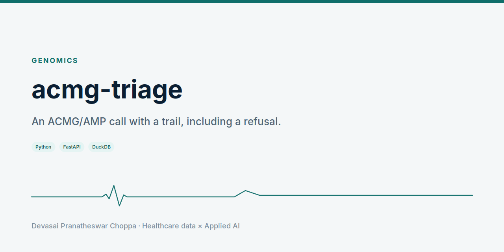
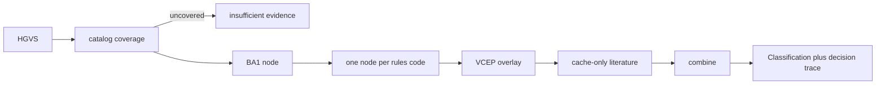

<picture>
  <source media="(prefers-color-scheme: dark)" srcset="docs/social-preview-dark.png">
  
</picture>

**An ACMG/AMP 2015 classification as a typed evidence trail, including an explicit refusal.**

<p align="center">
  
</p>

Research and decision-support tooling. Not a medical device. Not for patient care. The probes are designed samples, not a clinical cohort.

## Problem

A variant of uncertain significance needs a call a reviewer can retrace. Collapsing conflicting evidence into one tier hides the disagreement.

## Solution

`acmg classify` runs a typed graph: one node per rules code, a VCEP overlay, and literature nodes that read only `data/sample/literature_cache.json`. BA1 can skip the rest of the list. Conflicting directions stay conflicting. Uncovered variants return insufficient evidence.

The runner is LangGraph-shaped and does not import LangGraph. There is no live LLM in the default path.

## Architecture



Source: `src/acmg_triage/graph.py`.

## Tech stack

Python 3.11, Pydantic, Typer, Rich, DuckDB, FastAPI, pytest.

## Quickstart

```bash
make setup
make demo
```

`make demo` runs the designed sample plan, classifies the walkthrough variants, and regenerates the evaluation table. No credentials and no downloads.

Classify one variant:

```bash
acmg classify --hgvs "NM_000059.4:c.5946del" --explain
```

## Results

Regenerated by `make eval` from the committed harness:

| System | Concordance | n | Notes |
| --- | --- | --- | --- |
| Rules-only baseline | 0.670 | 100 | Default 2015 computational codes plus the combining table |
| Frequency-threshold-only | 0.770 | 100 | BA1, BS1, and PM2 only |
| Full system, literature cache | 0.670 | 100 | Matches the rules-only baseline |

## Roadmap

A live literature model is out of scope until it beats the rules-only column on a set that is not the designed probe file.

## License

MIT.
